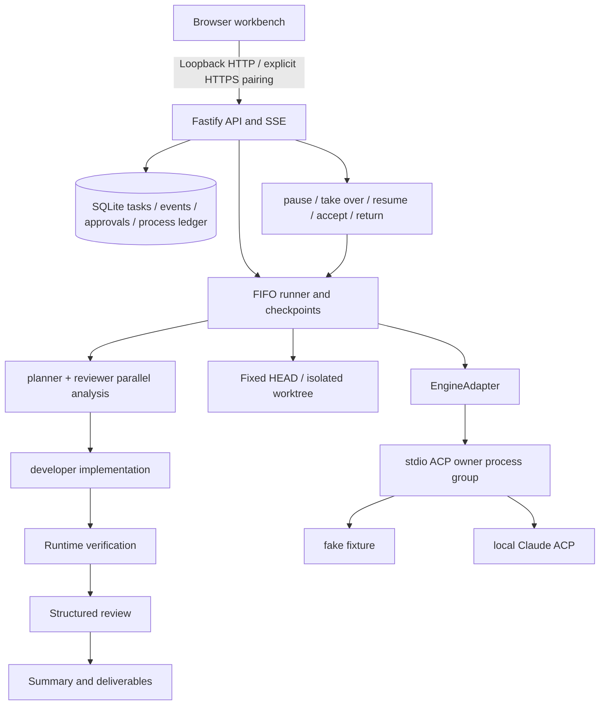

# Personal Agent

English | [简体中文](README.md)

Turn your own computer into a trustworthy AI development execution node: describe a goal, let multiple agents analyze, code, verify, and review in isolated worktrees, approve or take over whenever needed, and receive patches with real verification records.

[](LICENSE)
[](package.json)
[](https://github.com/dongdada29/personal-agent/actions/workflows/ci.yml)


## Why it exists

Independent developers often want to hand a goal to AI without giving up control over code, verification, approval, and delivery boundaries. Personal Agent keeps task history, agent roles, runtime verification, and human intervention in one local workbench: AI can execute, while the human can inspect, pause, approve, take over, and decide whether the result is accepted.

## Core features

- **Isolated worktree execution**: Claude tasks start from a fixed Git HEAD in a separate worktree and do not overwrite host work-in-progress.
- **Multi-agent pipeline**: planner, developer, and reviewer agents analyze, modify, verify, review, and summarize in stages.
- **Real verification evidence**: the runtime launches verification commands and records exit codes, stdout/stderr, and attempts.
- **Human controls and approvals**: add instructions, pause after a stage, take over immediately, resume, return for rework, and resolve tool approvals.
- **Durable events and recovery**: SQLite stores tasks, events, approvals, artifacts, and process ownership records; closing the page does not cancel work.
- **No-account fake demo**: the fake engine demonstrates the state flow in a temporary data directory without calling a real model.
- **Paired remote access path**: the author's instance is online through Cloudflare Named Tunnel in paired mode; full physical-phone mobile-network acceptance still needs target-environment validation.
- **Desktop client**: Electron can host or attach to a local instance; the renderer only sees `app://` and never the launch token.
- **Linux cloud computer**: manage Colima / WSL2 / Podman locally and SSH or an outbound host daemon in the cloud; desktops open only through the authenticated proxy.

## Five-minute local demo

Install Node.js **22.18 or newer**, npm, and Git, then run:

```sh
npm ci --ignore-scripts --registry=https://registry.npmjs.org --strict-ssl=true
npm run build
npm run smoke
npm run demo
```

Open the URL printed by the terminal, usually <http://127.0.0.1:47811/?demo=fake>. The standalone demo uses temporary data, the fake engine, and a port separate from the persistent service. Create a demo task, inspect events, artifacts, and controls, then accept the result.

## Architecture



## Screenshots

| Create task | Events and controls |
| --- | --- |
|  |  |

| Artifacts and verification | 390px mobile viewport |
| --- | --- |
|  |  |

## Details

### Current status

The current release is **v0.1.0** (`eeeca3c`). This branch adds the desktop client and Linux cloud computer on top of that. CI runs typecheck, the full test suite, build, doctor, smoke, the demo self-check, and the share check on Ubuntu, macOS, and Windows with Node 22.18.0 and 24.x, and also packages unsigned dmg / nsis / AppImage builds. Automated tests use temporary Git repositories, fake/mock engines, verification subprocesses, and virtual devices; they do not call real models or authorize real devices.

The workbench supports narrow screens and defaults to loopback access. Public access must use paired mode behind an HTTPS reverse proxy or Cloudflare Named Tunnel. The author's instance is online through Named Tunnel and paired mode; physical-phone mobile-network flows for create, approve, take over, reconnect, accept, and revoke still need target-environment acceptance. A single-machine deployment has no redundancy or automatic failover. Windows process ownership is implemented; remaining gaps are listed in [windows-gaps.md](docs/windows-gaps.md).

### First local demo

Install Node.js **22.18 or newer**, npm, and Git. Process management supports macOS, Linux, and Windows; remaining Windows gaps are listed in [windows-gaps.md](docs/windows-gaps.md).

From the source directory, run:

```sh
npm ci --ignore-scripts --registry=https://registry.npmjs.org --strict-ssl=true
npm run build
npm run smoke
```

`smoke` completes a fake ACP task in a temporary directory, should print `PASS`, `completed`, 13 events, and 1 artifact, and then cleans up its own data. It needs no model authentication and starts no persistent service.

To use the workbench interactively, run:

```sh
npm run demo
```

Open the URL printed by the terminal, usually <http://127.0.0.1:47811/?demo=fake>. The standalone demo uses temporary data, the fake engine, and a port separate from the persistent service, with one successful and one failed task preloaded; it does not open a browser for you. Enter a goal, click “创建演示任务” (create demo task), review the records and artifacts, then click “接收成果” (accept result). Press **Ctrl+C** to stop the demo; it removes its temporary data after execution finishes, and keeps the directory and ownership records if cleanup is blocked. To keep tasks, use a [persistent local instance](docs/getting-started.md#保留任务的本机实例).

### Public fake demo (Cloudflare Tunnel)

To put the demo on the public internet, do not expose the persistent instance. Use the server-enforced fake-only demo mode instead: it never registers repositories, runs Claude, executes verification commands, or constructs the real adapter, and URL-encoded or otherwise normalized path variants cannot bypass it. With a demo hostname configured, it additionally accepts only that exact HTTPS origin for Host and Origin, and mutations must be same-origin JSON:

```sh
npm run build
PERSONAL_AGENT_DEMO_PUBLIC_ORIGIN=https://<DEMO_HOSTNAME> npm run demo -- --port 47811
# cloudflared Named Tunnel: <DEMO_HOSTNAME> -> http://127.0.0.1:47811 (keep the original Host)
```

Task and mutation-rate limits, a cloudflared ingress example, and the launchd template [`deploy/launchd/org.personal-agent.demo.plist.example`](deploy/launchd/org.personal-agent.demo.plist.example) are described in [operations · public fake demo](docs/operations.md#公开-fake-演示cloudflare-named-tunnel).

The full walkthrough, reproducible HTTP demo, and real Claude fixture are in [getting started](docs/getting-started.md). Stopping, backup, upgrade, rollback, and recovery are in [operations](docs/operations.md), including [running under launchd](docs/operations.md#launchd-常驻) on macOS. Environment variables are documented in [`.env.example`](.env.example).

Screenshots and the GIF are generated by `scripts/capture-demo-assets.mjs`. Playwright is invoked temporarily through `npm exec` and is not added to the lockfile:

```sh
npm run build
npm exec --yes --package playwright -- node scripts/capture-demo-assets.mjs
```

### What it can do

| Capability | Current behavior |
| --- | --- |
| Task creation | fake demo; Claude uses local native credentials and runs in an isolated Git worktree |
| Execution visibility | durable events, agent stages, real verification output, patches, and summaries; SSE gaps can be replayed |
| Human control | add instructions, pause after stage, take over immediately, resume, retry, and cancel |
| Approval and delivery | tool requests wait for explicit allow/deny; completed tasks can be accepted or returned for rework |
| Restart recovery | registered process ownership is verified; active tasks become interrupted and resume only on user request |
| Instance settings | agent profiles and timeouts; a task snapshots settings at creation time |
| Device access | explicit paired mode, one-time pairing, CSRF protection, and device revocation; loopback by default |
| Desktop client | Electron hosts the bundled server or connects to `127.0.0.1:47801`; see [desktop client](docs/desktop.md) |
| Linux cloud computer | local Colima (default 2 vCPU / 4 GiB / 40 GiB) or a cloud host; desktops only through the authenticated proxy |
| Device executor | Default real-device channel is M1 (LLD12); skills call `DeviceExecutor`, not Appium. See [device executor](docs/device-executor.md) |

A single instance runs one task at a time in FIFO order, with up to two engine sessions during analysis. `completed` means execution ended; `accepted` means the human accepted delivery. Accepting a result does not commit, merge, push, or deploy code. Worktree isolation protects Git changes, not the operating system.

### Verification and delivery boundaries

```sh
npm run doctor
npm run demo -- --check
npm run typecheck
PERSONAL_AGENT_SSE_REAL_SOCKETS=1 \
GIT_CONFIG_GLOBAL=/dev/null GIT_CONFIG_SYSTEM=/dev/null GIT_CONFIG_NOSYSTEM=1 \
npm test -- --maxWorkers=1 --minWorkers=1
npm run smoke
npm run device:smoke
npm run build
npm run share:check
```

Automated tests use temporary Git repositories, fake ACP, verification subprocesses, and virtual devices, and never call a real model. The full suite creates and destroys test pairing tickets and sessions in temporary databases; it never grants access to a real device.

`share:check` must run inside a Git checkout and checks tracked files only. Source archives without `.git` should be verified with their SHA-256 manifest instead.

Historical acceptance records are preserved by date: on 2026-10-07 a clean checkout of `39fe311` passed 605 tests in 33 files on macOS arm64, and a real greeting fixture completed 5 stages, 5 AgentRuns, 3/3 runtime tests, and 8 artifacts; the 2026-10-06 three-environment results are kept separately. These describe those commits and machines only and do not replace the current v0.1.0 / `eeeca3c` CI. Historical commands and boundaries are in [local delivery acceptance](docs/delivery-acceptance.md), later Linux records are in [Linux cloud acceptance](docs/linux-cloud-acceptance.md), and sharing guidance is in [sharing and evidence](docs/sharing.md).

The service always listens on `127.0.0.1:47801`; the default no-login loopback mode must never be forwarded to the public internet. Device pairing, proxy configuration, and data migration are described in [device access](docs/device-access.md). Real-device observe/act goes through the [device executor](docs/device-executor.md): default channel M1, smoke with `npm run device:smoke` (fake) or `npm run device:smoke -- --real` (LLD12), never occupying 47801.

### Engineering and license

| Directory | Responsibility |
| --- | --- |
| `apps/server` | Fastify 5 API, SSE, same-origin Web serving, instance lock, startup recovery, and the box proxy |
| `apps/web` | React 18 / Vite 5 / Antd 5 workbench shared by the browser and the desktop client |
| `apps/desktop` | Electron main process, `app://` proxy, managed and connect modes |
| `deploy/box` | hardened pa-box image, seccomp, Xvnc unix sockets, and the gate |
| `packages/contracts` | shared types, task state machine, and error contracts |
| `packages/runtime` | Node SQLite, ACP, worktrees, pipeline, verification, checkpoints, and process ledger |
| `packages/device` | DeviceExecutor contract, M1Adapter wrapping ios_act, and the single-writer lease |
| `scripts` | local demo, fixture, restricted Claude probe, backup check, explicit pairing, device smoke, and box installers |

The project uses npm workspaces and TypeScript ESM. Dependencies are locked by `package-lock.json`; ACP SDK is **1.3.0** and Claude ACP is **0.65.0**. Model credentials are read by the engine from native local configuration. The project does not provide login or credential migration and does not require model secrets in `.env`.

The source is published in the [GitHub repository](https://github.com/dongdada29/personal-agent) on `main`; this showcase targets **v0.1.0** (`eeeca3c`). The project declares [Apache License 2.0](LICENSE) and preserves fixed-source attribution in [NOTICE](NOTICE). Dependencies keep their own licenses; see [third-party license notes](docs/third-party-licenses.md). Architecture notes and sharing checks are in [sharing](docs/sharing.md). Scope is tracked in the [MVP plan](plans/personal-agent-mvp-plan.md), with historical evidence in [phase 1](docs/phase1-acceptance.md), [phase 2](docs/phase2-acceptance.md), [phase 3](docs/phase3-acceptance.md), and [phase 4](docs/phase4-acceptance.md).
