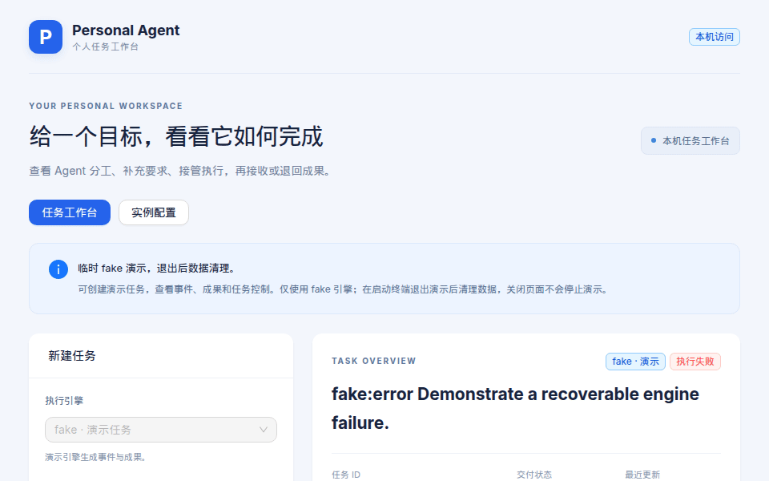
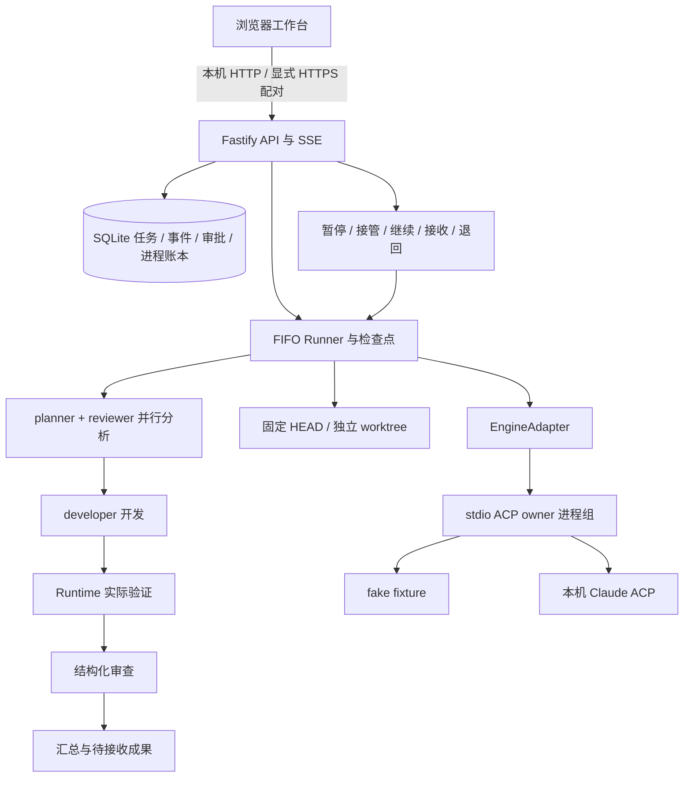
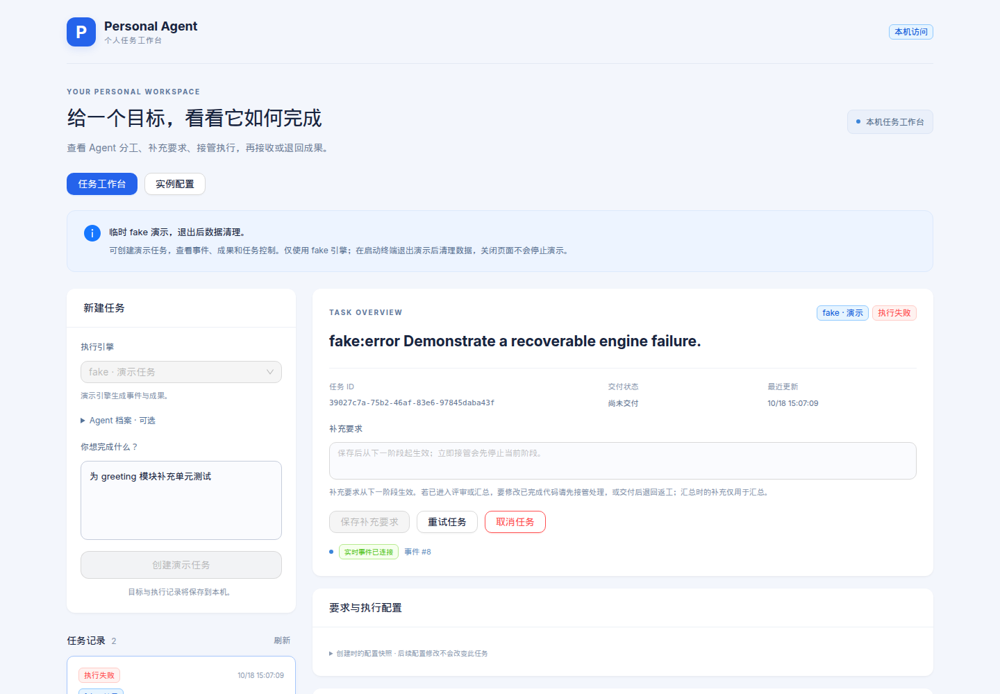
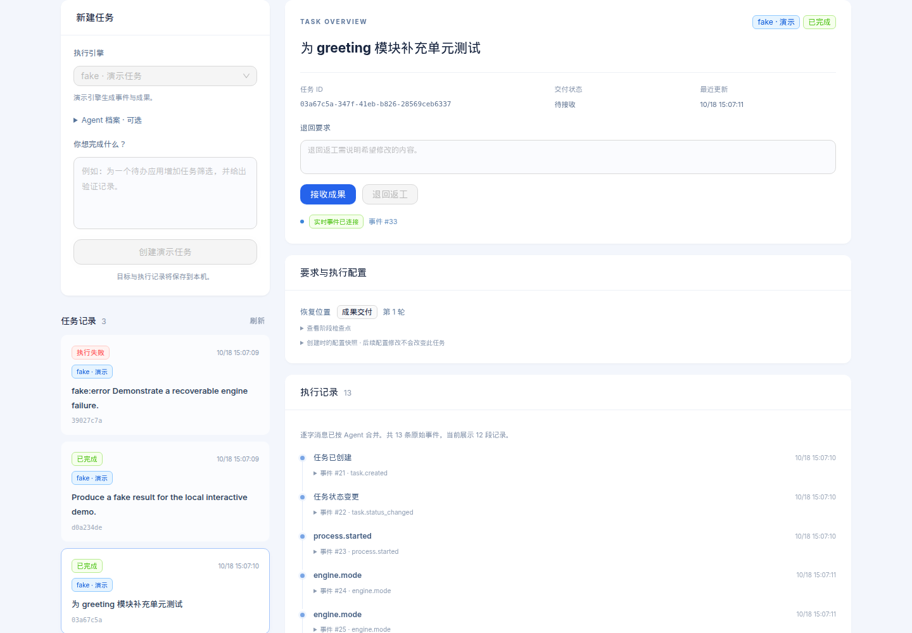
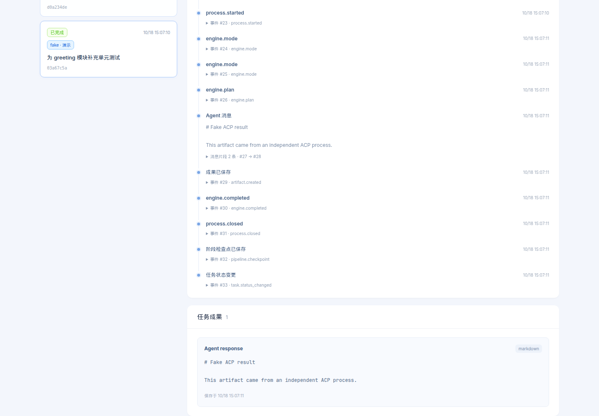
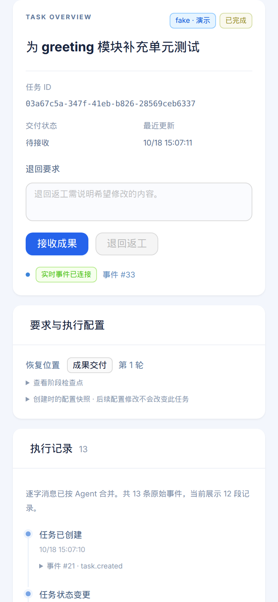

# Personal Agent

[English](README.en.md) | 简体中文

把自己的电脑变成可托付的 AI 开发执行节点：交代目标，多 Agent 在独立 worktree 中分析、编码、实测、审查，你随时审批、接管，最后接收带真实验证记录的补丁。

[](LICENSE)
[](package.json)
[](https://github.com/dongdada29/personal-agent/actions/workflows/ci.yml)



## 为什么做

个人开发者经常需要把一个目标交给 AI，但又不能放弃对代码、验证、审批和交付边界的控制。Personal Agent 把任务记录、Agent 分工、实际验证和人工接管放在同一个本地工作台里：AI 可以执行，人始终能查看、暂停、审批、接管和最终决定是否接收成果。

## 核心特性

- **独立 worktree 执行**：真实 Claude 任务以固定 Git HEAD 创建独立 worktree，不直接覆盖宿主目录 WIP。
- **多 Agent 流水线**：planner、developer、reviewer 分阶段分析、修改、验证、审查与汇总。
- **真实验证记录**：Runtime 实际启动验证命令，保存退出码、stdout/stderr 和执行尝试。
- **人工控制与审批**：支持补充要求、阶段结束暂停、立即接管、继续、退回返工和工具审批。
- **持久事件与恢复**：SQLite 保存任务、事件、审批、成果和进程账本；页面关闭不取消任务。
- **无账号 fake 演示**：`fake` 引擎可在临时数据目录中演示完整状态流，不调用真实模型。
- **paired 远程访问代码路径**：作者实例已通过 Cloudflare Named Tunnel 在 paired 模式下上线；完整实体手机移动网络流程仍需按目标环境单独验收。

## 五分钟本地体验

准备 Node.js **22.18 或更高**、npm 和 Git，然后运行：

```sh
npm ci --ignore-scripts --registry=https://registry.npmjs.org --strict-ssl=true
npm run build
npm run smoke
npm run demo
```

打开终端打印的地址，默认是 <http://127.0.0.1:47811/?demo=fake>。独立 demo 使用临时数据、fake 引擎和与正式实例不同的端口，预置成功和故障任务；填写目标后点击“创建演示任务”，查看事件、成果和控制区，最后点击“接收成果”。

## 架构图



## 截图

| 新建任务 | 事件流与控制区 |
| --- | --- |
|  |  |

| 成果与验证记录 | 390px 手机视口 |
| --- | --- |
|  |  |

## 详细说明

### 当前状态

当前发布版本为 **v0.1.0**（`eeeca3c`），全量测试为 **753 项、37 个测试文件**。CI 在 Ubuntu 与 macOS、Node 22.18.0 与 24.x 上运行类型检查、全量测试、构建、doctor、smoke、demo 自检和分享检查。自动测试使用临时 Git 仓库、fake/mock 引擎、验证子进程和虚拟设备，不调用真实模型，也不给真实设备开通访问。

浏览器工作台支持窄屏；默认入口是本机 loopback。公网访问必须启用 paired 模式并位于 HTTPS 反向代理或 Cloudflare Named Tunnel 后。作者的实例已经通过 Named Tunnel 与 paired 模式上线；实体手机关闭 Wi-Fi 后的完整创建、审批、接管、重连、接收和撤销流程仍按目标环境单独验收。Windows 进程管理暂不支持，单机部署没有冗余或自动故障切换。

### 首次本地演示

准备 Node.js **22.18 或更高**、npm 和 Git。当前进程管理支持 macOS/Linux POSIX；其他目标机器仍需复验，Windows 暂不支持启动。

在取得的源码目录运行：

```sh
npm ci --ignore-scripts --registry=https://registry.npmjs.org --strict-ssl=true
npm run build
npm run smoke
```

`smoke` 在临时目录完成 fake ACP 任务，预期输出 `PASS`、`completed`、13 条事件和 1 项成果，然后清理自建数据。它不需要模型认证，也不启动常驻服务。

想实际操作工作台，运行：

```sh
npm run demo
```

打开启动终端打印的地址，默认是 <http://127.0.0.1:47811/?demo=fake>。独立 demo 使用临时数据、fake 引擎和与正式实例不同的端口，预置成功和故障任务；不自动打开浏览器。填写目标后点击“创建演示任务”，查看记录和成果，点击“接收成果”。按 **Ctrl+C** 停止 demo，确认执行收尾后清理其临时数据；清理阻断时保留目录与归属记录。需要保留任务时使用 [持久实例启动](docs/getting-started.md#保留任务的本机实例)。

完整操作、可复现 HTTP demo 和真实 Claude fixture 见 [首次运行与任务流程](docs/getting-started.md)。停止、备份、升级、回滚和恢复见 [运行维护](docs/operations.md)，macOS 常驻运行见其中的 [launchd 常驻](docs/operations.md#launchd-常驻)。环境变量示例见 [`.env.example`](.env.example)。

截图和 GIF 由 `scripts/capture-demo-assets.mjs` 生成，Playwright 只通过 `npm exec` 临时调用，不写入依赖锁：

```sh
npm run build
npm exec --yes --package playwright -- node scripts/capture-demo-assets.mjs
```

### 可以做什么

| 功能 | 当前行为 |
| --- | --- |
| 创建任务 | fake 演示；Claude 使用本机已有认证，在独立 Git worktree 中执行 |
| 查看执行 | 持久事件、各 Agent 阶段、实际验证输出、补丁与汇总；SSE 断线后补发 |
| 人工控制 | 补充要求、阶段结束后暂停、立即接管、继续、重试和取消 |
| 审批与交付 | 工具请求等待明确允许/拒绝；完成后接收成果或带要求退回返工 |
| 重启恢复 | 核验已登记进程归属，活动任务进入 interrupted；用户明确继续后恢复 |
| 实例配置 | Agent 档案和执行超时；任务保存创建时快照，后续修改不改变既有任务 |
| 设备访问 | 显式 paired 模式、一次性配对、CSRF 与设备撤销；默认仅 loopback |

单实例按 FIFO 一次执行一个任务，分析阶段最多两个引擎会话并行。`completed` 表示执行完成，`accepted` 表示用户接收；接收不会提交、合并、推送或部署代码。worktree 隔离 Git 修改，不能充当操作系统沙箱。

### 验证与交付边界

```sh
npm run doctor
npm run demo -- --check
npm run typecheck
PERSONAL_AGENT_SSE_REAL_SOCKETS=1 \
GIT_CONFIG_GLOBAL=/dev/null GIT_CONFIG_SYSTEM=/dev/null GIT_CONFIG_NOSYSTEM=1 \
npm test -- --maxWorkers=1 --minWorkers=1
npm run smoke
npm run build
npm run share:check
```

自动测试使用临时 Git 仓库、fake ACP、验证子进程和虚拟设备，不调用真实模型。全量测试会在临时数据库生成并销毁测试配对票据和会话；它不会给真实设备开通访问。

`share:check` 需要在 Git 检出目录中运行，只检查已跟踪文件。接收无 `.git` 的源码归档时按提供的 SHA-256 清单核验，无需运行此维护命令。

历史验收记录按日期保留：2026-10-07 从 `39fe311` 的干净源码完成 605 项、33 文件的 macOS arm64 全量回归，以及当日真实 greeting fixture（5 阶段、5 次 AgentRun、Runtime 3/3 测试、8 项成果）；10 月 6 日三环境结果另行保留。这些历史结果只说明当日提交和机器状态，不能替代 v0.1.0 / `eeeca3c` 的当前 CI。历史命令和边界见 [本机交付验收](docs/delivery-acceptance.md)，后续 Linux 记录见 [Linux 云端验收](docs/linux-cloud-acceptance.md)，分享材料见 [分享与证据清单](docs/sharing.md)。

服务固定监听 `127.0.0.1:47801`，默认免登录本地模式不得直接转发到公网。设备配对、代理配置及原数据迁移见 [设备访问说明](docs/device-access.md)。

### 工程与许可

| 目录 | 职责 |
| --- | --- |
| `apps/server` | Fastify 5 API、SSE、同源 Web 托管、实例锁与启动恢复 |
| `apps/web` | React 18 / Vite 5 / Antd 5 浏览器工作台 |
| `packages/contracts` | 共享类型、任务状态机与错误契约 |
| `packages/runtime` | Node SQLite、ACP、worktree、流水线、验证、检查点和进程账本 |
| `scripts` | 本地演示、fixture、受限 Claude 探针、备份检查与显式配对操作 |

npm workspaces / TypeScript ESM；依赖由 `package-lock.json` 固定，ACP SDK **1.3.0**、Claude ACP **0.65.0**。模型凭据由引擎使用其本机原生配置，本项目不提供登录或凭据搬运服务，也不要求在 `.env` 中保存模型密钥。

项目源码已发布到 [GitHub 仓库](https://github.com/dongdada29/personal-agent) 的 `main`，当前展示基线为 **v0.1.0**（`eeeca3c`）。项目声明 [Apache License 2.0](LICENSE)，并保留固定来源 [NOTICE](NOTICE)。依赖采用各自许可，完整分发边界见 [第三方许可说明](docs/third-party-licenses.md)。架构、讲解提纲和分享检查见 [分享说明](docs/sharing.md)。实施边界见 [MVP 计划](plans/personal-agent-mvp-plan.md)，历史证据见 [阶段一](docs/phase1-acceptance.md)、[阶段二](docs/phase2-acceptance.md)、[阶段三](docs/phase3-acceptance.md)、[阶段四](docs/phase4-acceptance.md)。
